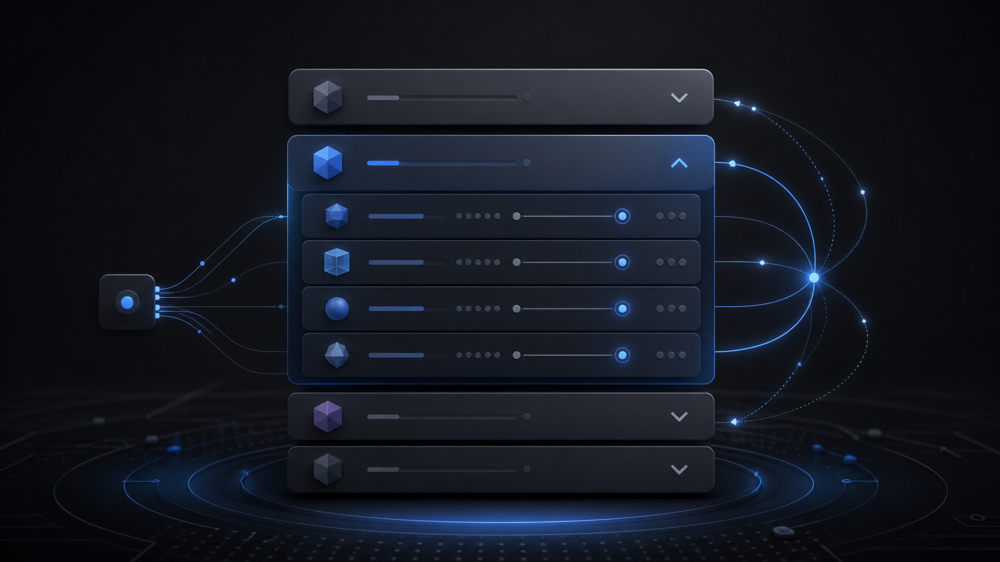
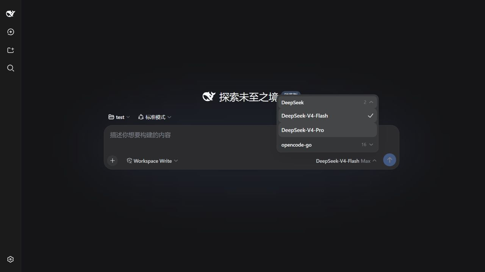
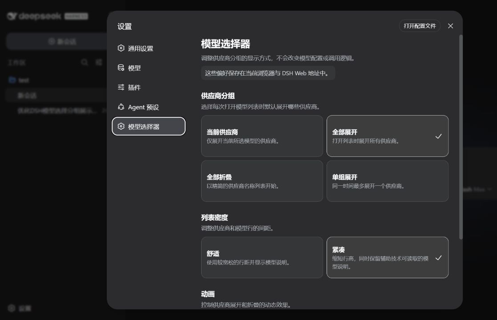

# DSH Collapsible Model Selector

为 DeepSeek Harness（DSH）的模型选择器添加按供应商独立折叠的分组界面，同时保留官方的数据、选择、配置和调用逻辑。

Adds independently collapsible provider groups to the DeepSeek Harness model selector while preserving the official data, selection, configuration, and invocation paths.

上图是 AI 生成的原创概念图，用于表达供应商分组、展开、折叠和模型连接关系，不代表 DSH 的实际界面或 DeepSeek 官方视觉。

## 实际界面

模型菜单：

设置页：

以上截图拍摄于旧版插件，0.2.3 的菜单外观跟随 DSH 0.2.0-rc.2。

## 功能

- 每个模型供应商可以独立展开或折叠，并显示模型数量。
- 可在 DSH 设置中选择“当前供应商”“全部展开”“全部折叠”或“单组展开”。
- 可切换舒适/紧凑列表密度，以及跟随系统/关闭折叠动画。
- 折叠使用短动画，并支持 `prefers-reduced-motion`。
- 提供 `menuitem`、`menuitemradio`、`aria-expanded`、`aria-controls`、`aria-checked` 和可见项键盘导航。
- 模型触发器支持上下方向键打开菜单，并按当前选项定位焦点。
- 保留 DSH 0.2.0-rc.2 的模型搜索与排序、键盘选择、待提交状态、加载重试和会话写入锁提示。
- 直接复用官方 `modelDirectories` 服务、`model` 本地化命名空间和选择数据结构。
- 自定义席位使用优先级 `-1`；模型目录接口缺失或席位同步渲染失败时，DSH 会退让到官方优先级 `0` 的选择器。选择请求失败会显示错误提示。
- 不新增命令、Host 配置 schema 或 RPC，也绝不重复注册官方 `model` 本地化命名空间。

## 设置

打开 DSH 的“设置”，选择“模型选择器”即可修改：

- 供应商分组的初始展开策略。
- 模型列表的舒适或紧凑密度。
- 折叠动画是否跟随系统设置。

默认值为仅展开当前供应商、舒适密度、动画跟随系统。偏好保存在当前 DSH 客户端的 `localStorage` 中，会即时生效并在重启后保留；Web 版与桌面版各自保存。它们不会修改模型配置或调用数据。存储不可用时，更改仅在当前页面生命周期内有效。

## 兼容性

`0.2.3` 以官方 `dsh-v0.2.0-rc.2` 源码和 npm 包为基线构建，目标是同版本的桌面应用 `desktop` profile。尚未验证其他 DSH 版本。要求 Node.js 22 或更高版本。

Version `0.2.3` is built against official DSH `0.2.0-rc.2` source and npm packages for the desktop application's `desktop` profile. Other DSH versions have not been validated.

## 安装与回退

通过 DSH 0.2.0-rc.2 的插件管理器向 `desktop` profile 安装本地 `0.2.3` tarball。安装后重启桌面应用，检查设置页、搜索、折叠、模型选择及失败提示。保留 Web 版原有 `0.2.2` 源码和包。卸载桌面版 `@local/dsh-ui-model-selection-collapsible` 后，官方优先级 `0` 的模型选择器继续提供默认席位。

本源码通过 TypeScript、Vitest、bundle 构建和模块加载检查；发行包由 `npm pack` 生成。

## 设计边界

插件只替换 `conversation.input.model` 的可视席位，并通过官方 `settings.section` 扩展点添加自己的设置页。它不会修改 DSH 官方插件或模型选择 RPC，也不会注册 `model` locale。`modelDirectories` 服务延迟出现或卸载时，自定义席位不会挂载；目录接口不符合预期或席位同步渲染失败时，DSH 的席位错误边界会退让到官方席位。异步模型选择失败时保留菜单并显示错误，不会触发官方席位退让。设置外壳不存在时，仅隐藏设置页，不影响模型席位。

## 项目状态

这是独立的社区插件，并非 DeepSeek 官方项目。`0.2.3` 是本次桌面迁移的本地构建，未作为 GitHub 版本发布。

## 许可证

插件代码采用 MIT License。基于 DeepSeek Harness 的组件行为和样式，并在 bundle 中包含 `clsx`；完整归属与第三方许可证见 [THIRD_PARTY_NOTICES.md](THIRD_PARTY_NOTICES.md) 和 [LICENSES](LICENSES)。
